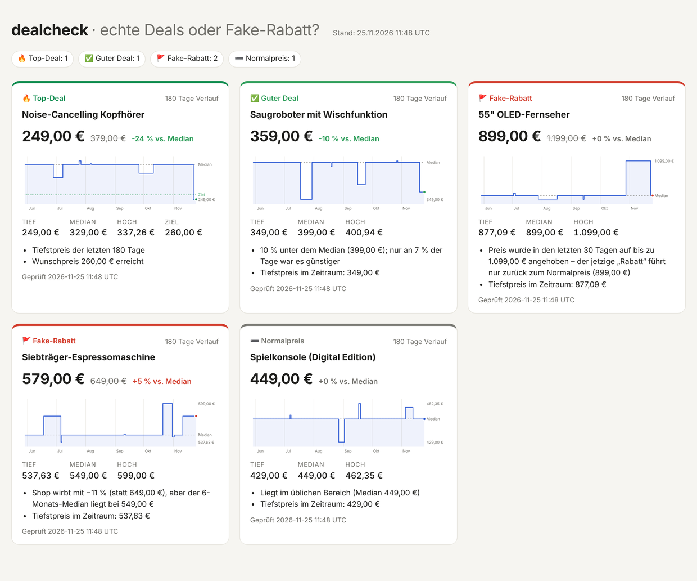

# dealcheck

[](https://github.com/faiyan-rahman/dealcheck/actions/workflows/ci.yml)


**A price-tracking agent that tells real Black Friday deals from fake discounts.**

Shops like to raise a price a few weeks before Black Friday and then "cut" it back to where it was.
dealcheck watches the products you care about, compares today's price against the **last 6 months**
and tells you, with reasons, whether it is a deal, a normal price or a fake discount. When something
is really cheap, it pushes a notification to your phone.



## What it does

- **Judges every price against 180 days of history:** 🔥 *Top deal*, ✅ *good deal*, ➖ *normal price*,
  📈 *too expensive* or 🚩 *fake discount*. Every verdict comes with the reasons behind it.
- **Catches pre-sale price hikes:** if the price went up in the last 30 days and the "deal" only brings it
  back to the median, the deal is flagged as fake.
- **Checks the shop's own claims:** reads the strike-through/RRP price and the *lowest price of the last
  30 days*, which EU shops must show by law (Omnibus directive, § 11 PAngV), and compares both with the
  real history.
- **Gets 6 months of history from day one** for Amazon through the [Keepa API](https://keepa.com/#!api).
  Other shops are tracked from the moment you add them.
- **Works with most shops without shop-specific code:** reads schema.org JSON-LD, microdata and
  OpenGraph, and has selectors for Amazon's markup.
- **Push notifications** via [ntfy](https://ntfy.sh) (free, no account) or Telegram: once when a deal
  appears or your target price is reached, and again only if it gets at least 3 % cheaper.
- **Runs for free on GitHub Actions** every 3 hours, commits the prices as CSV to the repo and publishes
  the dashboard to GitHub Pages. It also runs locally with `dealcheck watch`.

## Quickstart

```bash
pip install git+https://github.com/faiyan-rahman/dealcheck
dealcheck demo --open          # sample dashboard, no setup needed

dealcheck add "https://www.amazon.de/dp/B09XS7JWHH" --name "Sony WH-1000XM5" --target 249
dealcheck add "https://www.otto.de/p/..." --name "Saugroboter"
dealcheck check                # fetch, analyse, notify, write site/index.html
dealcheck watch -i 60          # keep checking every 60 minutes
```

```
🔥 Top-Deal            249,00 €  Sony WH-1000XM5
     • Tiefstpreis der letzten 180 Tage
     • Wunschpreis 249,00 € erreicht
🚩 Fake-Rabatt         899,00 €  55" OLED-Fernseher
     • Preis wurde in den letzten 30 Tagen auf bis zu 1.099,00 € angehoben – der jetzige
       „Rabatt" führt nur zurück zum Normalpreis (899,00 €)
```

The CLI and dashboard are in German because the tool targets German shops and EU price rules.

### Configuration

| Environment variable | Purpose |
|---|---|
| `KEEPA_API_KEY` | Amazon price history ([keepa.com](https://keepa.com/#!api), paid; the smallest plan is enough for a few dozen products) |
| `DEALCHECK_NTFY_TOPIC` | ntfy topic for push notifications. Install the ntfy app, subscribe to a long random topic name, then run `dealcheck test-notify` |
| `DEALCHECK_TELEGRAM_TOKEN`, `DEALCHECK_TELEGRAM_CHAT_ID` | Telegram bot instead of / in addition to ntfy |

Products live in [`watchlist.yaml`](watchlist.yaml). Secrets are only read from the environment, never
from the file.

### Running it on GitHub Actions

1. Fork or clone this repo and add your products to `watchlist.yaml`.
2. Under *Settings → Secrets and variables → Actions*, add `DEALCHECK_NTFY_TOPIC` and optionally
   `KEEPA_API_KEY`.
3. Under *Settings → Pages*, set *Source* to **GitHub Actions**.
4. Start the `track` workflow once by hand. After that it runs every 3 hours.

> [!NOTE]
> Amazon often shows a captcha to requests coming from data-centre IPs such as GitHub's runners. With a
> Keepa key this doesn't matter. Without one, run `dealcheck watch` on your own machine for Amazon.
> On a public repo, the dashboard and `data/` are public too.

## How the verdict works

Price histories are step functions: a price holds until it changes. Averaging the raw change events
would over-weight a two-day spike as much as a three-month plateau, so dealcheck first resamples
the history into **one price per day** (forward-filled, out-of-stock days skipped) and computes min,
median, 25th percentile and the 30-day range on that daily series. Today's price is compared against
the past only.

| Verdict | Rule |
|---|---|
| 🔥 Top deal | ≤ 1 % above the 180-day low **and** at least 3 % below the median |
| ✅ Good deal | ≥ 10 % below the median, or below the 25th percentile and ≥ 3 % below the median |
| 🚩 Fake discount | the price was raised > 10 % above the median in the last 30 days and is now back at roughly the median, **or** the shop advertises a strike-through price while the price is at or above the median |
| 📈 Too expensive | ≥ 5 % above the median |
| ➖ Normal | everything else |
| ❔ Not enough data | less than 14 days of history |

## Architecture

```
watchlist.yaml ─▶ tracker.run ─┬─▶ fetchers.keepa   (Amazon history, 180 days)
                               ├─▶ fetchers.html    (JSON-LD / microdata / Amazon / Omnibus text)
                               ▼
                        storage (data/prices/<id>.csv, data/state.json)
                               ▼
                        analysis.analyze ─▶ notify (ntfy, Telegram)
                               ▼
                        report.build ─▶ site/index.html (static, inline SVG charts)
```

Storage is plain CSV on purpose: the history stays diffable, so the scheduled workflow can commit it back
to git ("git scraping") and no database is needed.

## Development

```bash
git clone https://github.com/faiyan-rahman/dealcheck && cd dealcheck
pip install -e ".[dev]"
pytest
ruff check src tests
```

The tests use saved HTML pages and synthetic histories and never touch the network.

## Limitations

- Shops change their markup. If a shop has no structured data, the price may not be found. Please
  open an issue with the URL.
- Only use it for personal price tracking at a polite interval, and respect the shops' terms of service.

## License

MIT
